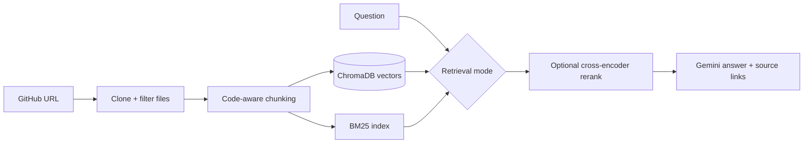

# AskMyRepo: Chat with Any GitHub Codebase

**A RAG-powered assistant that answers questions about a public GitHub repository, with citations linking back to the exact source files.**

[](https://www.python.org/)
[](https://streamlit.io/)
[](https://www.llamaindex.ai/)
[](https://ai.google.dev/)
[](https://www.trychroma.com/)

Paste a repo URL, index it, and ask things like *"How does token signing work?"* or *"Where is the serializer defined?"* Answers are grounded in retrieved code and link to the indexed commit.


<p align="center">
  
</p>


## Highlights

- **End-to-end RAG pipeline:** clone, filter, chunk, embed, index, retrieve, generate, cite.
- **Three retrieval strategies, benchmarked:** vector search, hybrid BM25 + vector (reciprocal rank fusion), and hybrid + cross-encoder reranking.
- **Code-aware chunking:** language-aware splitting with a sentence-based fallback.
- **Measured, not guessed:** a retrieval benchmark (Hit@k, MRR, precision, recall, F1) compares four configurations.
- **Cited answers:** every response links to the source files at the indexed commit.
- **Persistent index:** ChromaDB stores embeddings, so repos are not re-indexed for every question.

## Results

I built a small benchmark (12 questions on [`pallets/itsdangerous`](https://github.com/pallets/itsdangerous)) to test which retrieval choices actually help, instead of judging by how answers feel.

| Configuration | Hit@1 | Hit@5 | MRR | Precision | Recall | F1 |
|---|---:|---:|---:|---:|---:|---:|
| Baseline: default chunks + vector | 58.3% | 91.7% | 0.701 | 28.6% | 79.2% | 0.406 |
| **Code-aware chunks + vector** | **75.0%** | 100% | **0.875** | **65.3%** | 79.2% | **0.693** |
| Code-aware + hybrid (BM25 + vector) | 50.0% | 100% | 0.708 | 47.8% | **83.3%** | 0.562 |
| Code-aware + hybrid + reranking | **75.0%** | 100% | 0.850 | 38.5% | 72.9% | 0.486 |

**Takeaways**

- **Code-aware chunking gave the clearest win:** Hit@1 rose from 58.3% to 75.0%, MRR from 0.701 to 0.875, and precision more than doubled.
- **More complexity did not mean better results.** Hybrid retrieval improved coverage (recall, Hit@5) but hurt ranking, and reranking did not beat the simpler code-aware vector setup.
- **Retrieval quality is workload-dependent**, which is why it is worth measuring.

*Scope: 12 questions, one repository, file-level retrieval only. It does not measure answer correctness, citation faithfulness, latency, or cost, so treat it as an initial experiment. Reproduce with `python eval/run_eval.py` (results are written to `eval/results_per_question.csv`).*

## How it works



| Mode | Approach |
|---|---|
| Vector | Semantic similarity over embeddings (baseline) |
| Hybrid | BM25 keyword + vector retrieval merged with reciprocal rank fusion |
| Hybrid + rerank | Larger candidate set reordered by a cross-encoder |

## Tech stack

Python · Streamlit · LlamaIndex · Google Gemini (LLM + embeddings) · ChromaDB · BM25 · Sentence Transformers (cross-encoder) · GitPython

## Quick start

```bash
git clone https://github.com/agrwChaitanya/AskMyRepo.git
cd AskMyRepo
python -m venv .venv
source .venv/bin/activate        # Windows: .\.venv\Scripts\Activate.ps1
pip install -r requirements.txt
```

Create a `.env` file with your [Gemini API key](https://ai.google.dev/) (never commit it):

```env
GEMINI_API_KEY=your_gemini_api_key
```

Then run:

```bash
streamlit run app.py
```

Optional: set `LLM_MODEL` and `EMBEDDING_MODEL` to override the default Gemini models. Streamlit secrets are also supported for deployment.

## Project structure

```text
├── app.py              # Streamlit UI and chat workflow
├── indexer.py          # Cloning, file filtering, chunking, indexing
├── retrieval.py        # Vector, hybrid, and reranking strategies
├── query_engine.py     # RAG query engine and answer prompt
├── model_provider.py   # Gemini LLM and embedding setup
├── config.py           # Credentials and model configuration
└── eval/               # Benchmark questions, runner, and results
```

Ingestion, retrieval, and generation live in separate modules so each stage can be tested and swapped independently.

## Limitations and next steps

This is a portfolio project, not a production service. Planned improvements:

- Expand the benchmark across more repositories, languages, and question types.
- Evaluate answer correctness, citation faithfulness, latency, and API cost.
- Add smoke tests and pinned dependencies for reproducibility.
- Make indexing more resilient (failure handling, protection of existing indexes).
- Add resource limits and test prompt-injection resistance against untrusted repo contents.

## Author

**Chaitanya Agarwal** · [GitHub](https://github.com/agrwChaitanya)